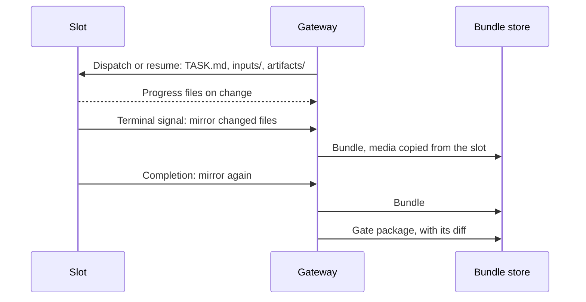

import { useEffect, useRef, useState } from 'react';
import useBaseUrl from '@docusaurus/useBaseUrl';
import { useColorMode } from '@docusaurus/theme-common';

export const RunDataMap = () => {
  const frame = useRef(null);
  const [height, setHeight] = useState(760);
  const { colorMode } = useColorMode();
  const src = useBaseUrl('/explainers/run-data-map.html');
  const sendTheme = (theme) =>
    frame.current?.contentWindow?.postMessage(
      { type: 'run-data-map:theme', theme },
      window.location.origin,
    );
  useEffect(() => {
    const onMessage = (event) => {
      if (event.source !== frame.current?.contentWindow) return;
      if (event.data?.type === 'run-data-map:height' && event.data.height > 0)
        setHeight(event.data.height);
    };
    window.addEventListener('message', onMessage);
    return () => window.removeEventListener('message', onMessage);
  }, []);
  useEffect(() => sendTheme(colorMode), [colorMode]);
  return (
    <figure style={{ margin: '1.5rem 0' }}>
      <iframe
        ref={frame}
        src={`${src}?embed=1`}
        onLoad={() => sendTheme(document.documentElement.getAttribute('data-theme'))}
        title="Run Data Map: an interactive map of how a run's data moves, in eight steps"
        loading="lazy"
        style={{ width: '100%', height: `${height}px`, border: 0, display: 'block' }}
      />
      <figcaption style={{ marginTop: '0.5rem', fontSize: '0.875rem' }}>
        Step through the eight moments of a run.{' '}
        <a href={`${src}?theme=${colorMode}`} target="_blank" rel="noopener">
          Open the full explainer
        </a>{' '}
        for the rules, tables and known limitations.
      </figcaption>
    </figure>
  );
};

# Run data flow

A run's data lives in five places: the slot running the worker, the gateway,
the bundle store, the storage archive, and each client's offline store. This page
shows what moves between them and when. The canonical reference, with every
size, cap, guard and code reference, is
[Run data sync](https://github.com/deeeed/farmslot/blob/main/docs/reference/run-data-sync.md).

<RunDataMap />

## Six rules

1. **Live means small.** While a worker runs, only the checklist, `SIGNAL.json`,
   acceptance status and subtasks stream to the gateway, as whole small files
   after a 1 s debounce. The terminal pane streams only while someone watches it.
2. **Big things move at checkpoints.** Artifacts, screenshots, video and diffs
   stay on the slot until the terminal signal, completion, the gate package or an
   explicit mirror refresh. A mirror copies only files whose size and hash
   changed, in hash-verified 512 KiB chunks.
3. **A bundle is the record.** Each capture becomes an immutable bundle named by
   its manifest's SHA-256. Readers use the bundle, never the slot or the mutable
   task directory.
4. **Clients ask what changed first.** A client reads ids and versions, then
   fetches only the rows whose version moved. A push carries a key, and an
   entity body only when it changed and fits in 16 KiB.
5. **Paint from the store, then refresh.** Command Center and Companion keep an
   offline SQLite store and paint from it before any request. Only observed
   screens refetch, with a minimum interval for busy families.
6. **Preload only what you would open offline.** In the background, clients
   fetch what a pending gate or an active run needs: details, the diff, and both
   sides of touched files, under caps of 5 MiB per diff, 1 MiB per file and
   2 MiB per image. Everything else loads when opened.

## A run's checkpoints

A follow-up run on another slot or node, such as PR completion or a fix, gets
the parent's small structured context (task, checklist, report, recipe, task
actions) from the parent's bundle in `inputs/inherited/`. Media, diffs and
signals are not copied, and code travels by git branch or PR.

## Storage

There are two archives. `run.archive` moves a run **record** to the record
archive, where it is kept forever. The hourly retention pass moves a settled
run's **bytes** (task directory, bundle, session archives, native sessions) to
`FARMSLOT_RUN_ARCHIVE_ROOT` once the run has been settled for the configured
retention period (default 7 days; see the retention setting in
[ADR-039](https://github.com/deeeed/farmslot/blob/main/docs/adr/039-run-portable-bundles.md)),
has no `keep` tag and holds no slot. The latest review of each open PR is kept
regardless of age; other runs on an open PR follow the age rule. Task pins and review
workspaces can be recreated, so retention deletes them. Restore from the archive
is manual.

## Known limitations

The reference lists structural gaps in the current code, each with the file it
cites: some diff files are written after the last capture, archived bundles are
not read back, gate diffs use abbreviated blob ids that defeat prefetch reuse,
the decision list has no versions path, artifacts download again on each open,
the Command Center artifact browser fetches listed files eagerly, and the four
diff producers filter files differently. See
[Known limitations](https://github.com/deeeed/farmslot/blob/main/docs/reference/run-data-sync.md#known-limitations).

## Related

- [Resource management and streaming](./resource-management-and-streaming.md)
- [Gateway control plane](./gateway.md)
- [Retained run artifacts](https://github.com/deeeed/farmslot/blob/main/docs/reference/retained-run-artifacts.md)
- [Gateway change notifications](https://github.com/deeeed/farmslot/blob/main/docs/reference/gateway-change-notifications.md)
