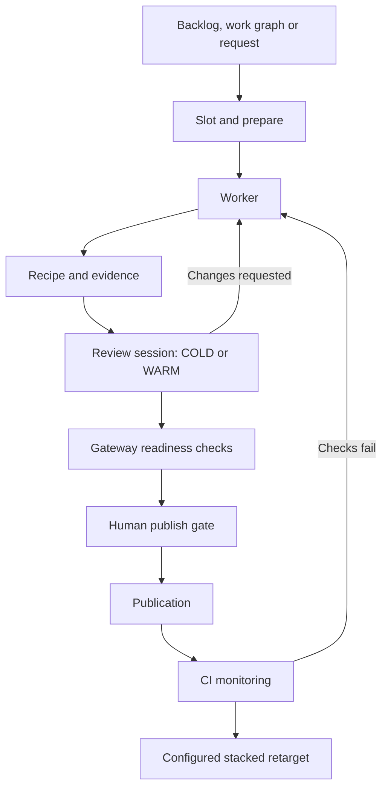

# How Farmslot works

Each piece of work is a run. The gateway owns its state, slot assignment,
approval gate and publication. Project packs declare policy and preparation
requirements. Workers write code and recipes; the recipe engine records execution
and derives claim evidence. Command Center, Companion and the CLI read the same
gateway facts. See the [introduction](../intro.md) for the product overview.

## From request to publication

1. Dispatch creates a run from a backlog item, work graph or direct request and
   chooses its flow.
2. The gateway claims a slot, an isolated project checkout on a configured node.
   Prepare syncs sources, copies configured fixtures and checks required resources.
   The pack declares those needs; Farmslot performs the preparation.
3. The worker follows the generated task folder's brief, acceptance criteria and
   checklist. The `mark` helper records progress and completion. The worker does
   not hand-write the signal file.
4. A recipe exercises the behavior and asserts the expected result. The engine
   retains the trace, recording where supported, and claim verdicts and moments.
   A successful action alone proves no claim. Visual claims await review of the
   pixels. Non-UI claims use executed assertions, such as a test command followed
   by an assertion on its output.
5. A separate reviewer session checks the change. COLD starts fresh for the whole
   diff. WARM resumes an identified reviewer session for the delta since its last
   reviewed head. A reviewer may use the same runner as the worker. An explicit
   WARM request refuses unavailable lineage; a policy that permits either mode
   can use COLD when no prior session exists.
6. The gateway checks deterministic receipts, review results, CI decision checks
   and evidence before the publish gate can advance. A person approves or rejects.
   Frozen evidence and validation identity must still match at publication.
   Title and description edits are re-rendered at approval.
7. Publication opens or updates the pull request using the approved selection.
   The gateway then monitors CI; a failure can dispatch a fix run on that branch.
8. For stacked work, a configured work-graph rebase edge can retarget the child
   after its parent merges. Branch updates wait until conflicting family work
   settles. Without that edge, the operator owns retargeting.

This diagram describes autonomous development and bug-fix runs. The
[generated flow table](../reference/run-states-and-gate.generated.md#flows-and-publication)
shows the actual steps for every flow. QA and review flows end with a report or
posted review and open no new PR. Maintenance flows update an existing PR.
Interactive development is operator-driven and may create its own draft PR.

## Evidence and the current transition

ADR-062 assigns normal recipe verdicts to the engine. That cutover is not complete:
workers can still record task verdicts with `farmslot-agent ac set`, and recipe
runs can project derived claims through the same task-ledger file writer. Those
are two verdict-producing paths today. A schema-1 task ledger is not a schema-2
recorded recipe package and provides no recording timeline by itself.

Workers also write the evidence selection list that the gateway freezes. The
approved target is one engine-owned immutable package per attempt, with reruns
retaining earlier attempts. Package immutability and single-writer migration
remain pending work; do not treat the target as a guarantee of current outputs.
See [Recipe evidence loop](./recipe-evidence-loop.md) for the proof contract.

## Stops and recovery

Missing or failed prerequisites keep advancement closed with a reason. Review
change requests send work back for a fix round. Uncertain delivery requires
reconciliation rather than an assumption that the worker stopped. Recovery uses
recorded state and existing resource ownership; it does not silently repeat an
external action. A run state alone is not a success verdict. See
[Run states and the gate](../reference/run-states-and-gate.generated.md).
