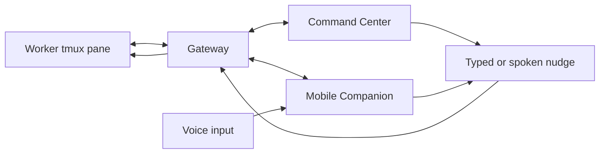
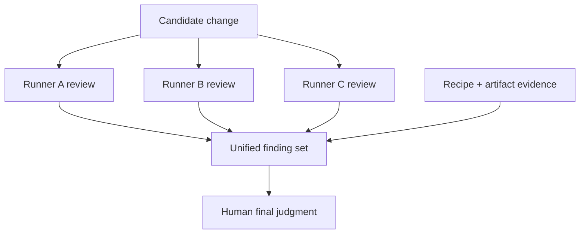

# Observability and interoperability

Farmslot's leverage comes from two ideas working together:

1. **Observability** — the operator can see what every worker is doing.
2. **Interoperability** — different runners, models, devices, and product surfaces can participate in the same supervised workflow.

This is what turns many separate agent sessions into one coherent engineering system.

## Not one black box

A Farmslot worker should never be an invisible background job that occasionally emits a diff.

The operator should be able to inspect:

- which slot is running the work;
- which runner/model/profile is being used;
- the live terminal or tmux pane;
- current workflow phase;
- task context and acceptance criteria;
- artifacts, diffs, screenshots, traces, logs, and decisions;
- whether the worker is progressing, stuck, or drifting.

## Steering from anywhere

Because worker state flows through the gateway, steering does not have to happen from the original terminal.

The operator can intervene from Command Center at the desk or from Mobile Companion away from the desk. Steering can be a typed instruction, a structured action, or a spoken nudge that the companion turns into a bounded worker message.

## Review sessions

Each review runs in its own session. Runner choice does not change whether the review qualifies. Configure runner, model, effort and mode in the shared review-and-dispatch picker.

COLD opens a fresh session for the whole diff. WARM resumes the identified prior reviewer session for the delta since its last reviewed head. The request carries that lineage separately from selection; missing or ambiguous WARM context is refused. Findings keep their session provenance and use recipe evidence to resolve disagreements.

## Super-engineer effect

The goal is not to pretend every runner is equally good at everything. The goal is to compose their strengths while keeping the human in control.

Farmslot gives one operator:

- parallel implementation capacity;
- multiple independent review perspectives;
- shared evidence and traceability;
- live steering from desktop or mobile;
- a queue that keeps capacity filled;
- final visual and code validation before approval.

That combination creates the “super-engineer” effect: not because the human stops reviewing, but because the human can coordinate more high-quality work without losing observability or control.
