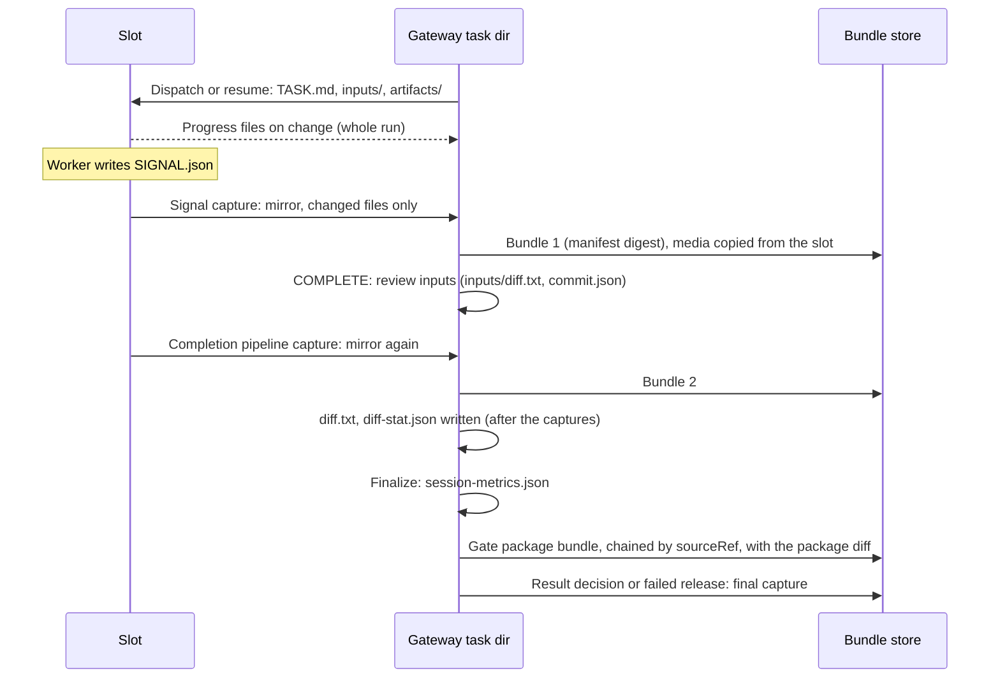
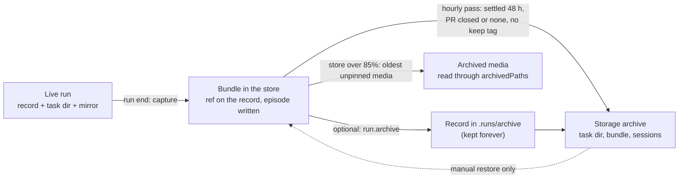
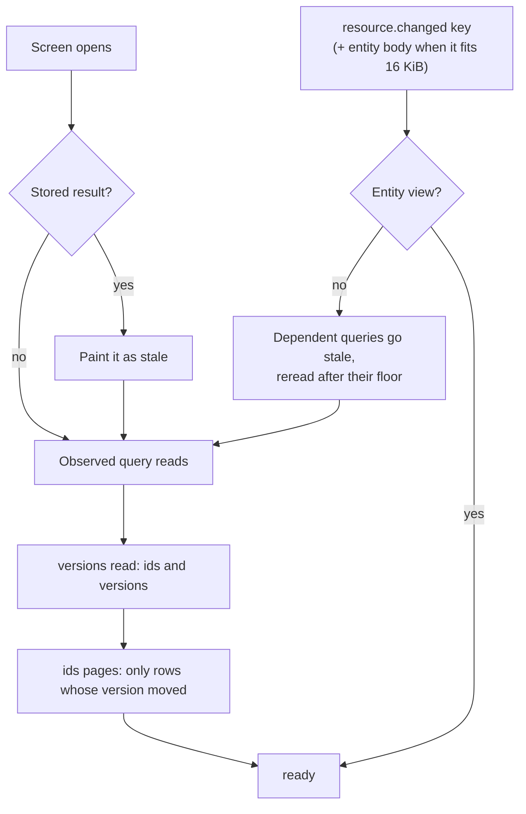

# Run data sync

**Status:** Reference. Describes what the code does; it adds no contract.
**Owners:** the decisions stay in [ADR-039](../adr/039-run-portable-bundles.md) (bundles, retention, archive), [ADR-071](../adr/071-gateway-change-notifications.md) (notifications and the client store), [ADR-008](../adr/008-remote-communication.md) and [ADR-035](../adr/035-node-support-bundles.md) (nodes). The normative detail stays in [Retained run artifacts](retained-run-artifacts.md), [Gateway change notifications](gateway-change-notifications.md) and the [Node link protocol](node-link-protocol.md). This page links to them instead of restating them.
**Reader version:** the website page `apps/docs/docs/architecture/run-data-flow.mdx` and its interactive map `apps/docs/static/explainers/run-data-map.html`.

This page follows a run's data across the slot, the gateway, the bundle store,
the storage archive and each client's offline store. For each move it says what
moves, when, how much, what stops it from moving too often, and where the code
is. Code references are repository paths with line numbers at the time of
writing; follow the symbol if a line has moved.

## The model in plain words

1. **Live means small.** While a worker runs, only small files stream to the
   gateway: the checklist, `SIGNAL.json`, acceptance status and subtasks. The
   terminal pane streams only while someone watches it.
2. **Big things move at checkpoints.** Artifacts, screenshots, video and diffs
   stay on the slot until a checkpoint: the terminal signal, completion, the gate
   package or an explicit mirror refresh. A mirror copies only files whose size
   and hash changed.
3. **A bundle is the record.** Each capture becomes an immutable bundle named by
   its manifest's SHA-256. Readers (the artifact route, reviews, follow-up runs)
   read the bundle, not the slot and not the mutable task directory.
4. **Clients ask what changed first.** A client reads a list of versions, then
   fetches only the rows whose version moved. A push carries a key, plus an
   entity body only when it changed and fits in 16 KiB.
5. **Paint from the store, then refresh.** Each client keeps an offline SQLite
   store and paints from it before any request. Only observed queries refetch,
   and busy families have a minimum interval between rereads.
6. **Preload only what you would open offline.** In the background, clients fetch
   what a pending gate or an active run needs, under per-item caps. Everything
   else loads when opened.

## Where a run's data lives

| Place                  | Holds                                                                                                                    | Owner                                                                                             |
| ---------------------- | ------------------------------------------------------------------------------------------------------------------------ | ------------------------------------------------------------------------------------------------- |
| Slot worktree          | The worker's task copy, artifacts, screenshots, video, the git worktree                                                  | The worker, until release                                                                         |
| Gateway run store      | Run record `<runsDir>/<id>.json`, decision journal, bundle intents, session archives, episodes                           | `services/gateway/src/runs/store.ts`                                                              |
| Gateway task directory | `TASK.md`, `inputs/`, gateway-written `artifacts/` files, and the mirror (acquisition staging, not a read source)        | `services/gateway/src/run-completion/artifact-mirror.ts`                                          |
| Bundle store           | `sha256/<digest>/{manifest.json, runs/<id>.json, tasks/...}`, immutable                                                  | `packages/run-bundle/src/retained.ts`, [Retained run artifacts](retained-run-artifacts.md)        |
| Storage archive        | `FARMSLOT_RUN_ARCHIVE_ROOT/<runId>/`: moved task directories, bundles, session archives, native sessions, with a journal | `services/gateway/src/runs/storage-archive.ts`                                                    |
| Record archive         | `<runsDir>/archive/<id>.json`, kept forever                                                                              | `services/gateway/src/runs/store.ts:2295-2366`                                                    |
| Client store           | Query results and verified content, per gateway connection and principal                                                 | `packages/protocol/src/client-cache/`, `packages/local-store/`, [ADR-071 Amendment 1][adr071-am1] |

## Slot and gateway during a run

The node watches progress files and sends the whole file when it differs from
the last read. Local slots use the gateway's own file watcher instead
(`services/gateway/src/tasks/watcher.ts:480-581`). Nothing large moves while the
worker runs.

| What                                                              | When                                 | Size / cap                              | Guard                                                           | Where                                                                                                                   |
| ----------------------------------------------------------------- | ------------------------------------ | --------------------------------------- | --------------------------------------------------------------- | ----------------------------------------------------------------------------------------------------------------------- |
| Checklist, `SIGNAL.json`, acceptance status, operations, subtasks | On file change (`node.fs.changed`)   | The whole file per change               | Content dedupe on the node, 1 s gateway debounce, checkbox hash | `packages/capabilities/src/fs-watch.ts:58-98`, `services/gateway/src/tasks/watcher.ts:175,583-698,994-1039,1277`        |
| Monitor fallback                                                  | 60 s poll                            | Signal and pane, tiny                   | Only when a push was missed                                     | `services/gateway/src/run-engine/run-monitor.ts:172`                                                                    |
| Terminal pane                                                     | Every 500 ms while a client views it | Pane text                               | Sent only when the pane changed                                 | `services/gateway/src/runtime/tmux-stream.ts:21,89-117`                                                                 |
| Interactive terminal                                              | While attached                       | Bounded rolling screen on the node link | SSH and `tmux attach` when the node link is off                 | `services/gateway/src/runtime/pty-stream.ts:80-170`                                                                     |
| Native conversation                                               | While subscribed                     | Snapshot, then deltas                   | Bounded to 400 rows or 832 KiB on open                          | `services/gateway/src/resources/native-conversations.ts:527-545`, `packages/protocol/src/rpc/native-session.ts:499-506` |
| Metrics, tmux workers                                             | 30 s metrics; 2 s worker sample      | Small                                   | Only changed worker snapshots are sent                          | `services/gateway/src/server/route-method.ts:1654-1690`, `services/node/src/commands/tmux-worker-watch.ts:7,140`        |
| Exec output                                                       | Per command                          | Streamed                                | None needed                                                     | `services/gateway/src/core/exec.ts:442-462`                                                                             |
| Live recipe context                                               | On demand, when a screen reads it    | Worker artifact files                   | 5 s per-file cache                                              | `services/gateway/src/live-recipe/context.ts:204,257,383`                                                               |
| Artifacts, screenshots, video, task directory, git diff           | Not synced while the worker runs     | n/a                                     | Moved only at the checkpoints below                             | n/a                                                                                                                     |

Remote nodes hold one outbound authenticated WebSocket to the gateway; commands
travel as request and response frames on it. With the typed node link enabled
(`FARMSLOT_NODE_LINK_ENABLED`, off by default), file and process operations carry
durable receipts and the frame, chunk and connection ceilings in
[Bounds and scheduling](node-link-protocol.md#bounds-and-scheduling).

## Checkpoints and the bundle

Big data moves at named checkpoints. A mirror walks the slot, compares each
selected file's size and remote `fs.hash` with the gateway copy, and copies only
what changed (`services/gateway/src/core/slot-io.ts:408,489-494`). Package caps
are checked before any copy (`services/gateway/src/run-completion/artifact-mirror.ts:548`).
Small files go in one read; larger files go in hash-verified 512 KiB chunks
(`packages/protocol/src/rpc/file-transfer.ts:10`). Media never lands in the
mirror: it is fingerprinted on the slot and copied straight into the bundle once
the bundle's metadata commits (`services/gateway/src/run-completion/retained-artifacts.ts:108-147`).

| Checkpoint                      | What is captured                                                                                                                       | Where                                                                                                                           |
| ------------------------------- | -------------------------------------------------------------------------------------------------------------------------------------- | ------------------------------------------------------------------------------------------------------------------------------- |
| Terminal signal                 | Mirror, scan of the gateway task directory, report, bundle                                                                             | `services/gateway/src/run-engine/post-dispatch-steps.ts:679-688`, `services/gateway/src/run-completion/output.ts:265-397`       |
| COMPLETE step                   | Retained-capture repair, review inputs (`inputs/diff.txt`, `inputs/diff-stat.json`, `inputs/commit.json`), completion pipeline capture | `post-dispatch-steps.ts:1754,1819,1865`, `services/gateway/src/run-completion/orchestrator.ts:1201,1220`                        |
| Diff write                      | `artifacts/diff.txt`, `diff-stat.json`, the last three `diff.txt.previous.*`                                                           | `post-dispatch-steps.ts:1885`, `services/gateway/src/run-engine/diff-artifacts.ts:860-975`                                      |
| Finalize                        | `artifacts/session-metrics.json`                                                                                                       | `services/gateway/src/run-engine/finalize-step.ts:316-337`                                                                      |
| Gate package                    | The review-snapshot diff, retained as `gatewayFiles` in a new bundle chained by `sourceRef`                                            | `run-completion/orchestrator.ts:741-760,824-942`                                                                                |
| Explicit refresh                | `run.refreshMirror`, the bundle retain backfill                                                                                        | `services/gateway/src/methods/run/engine-ops.ts:104`, `services/gateway/src/methods/run-bundle.ts:80`                           |
| Result decision, failed release | Final-result capture, without rewriting the judged report                                                                              | `run-completion/output.ts:230`, `services/gateway/src/methods/slot/release.ts:927-937`, `run-completion/result-decision.ts:443` |

What a mirror selects: evidence-manifest paths, recipe artifacts, the promoted
recipe-run snapshot without its screenshots, files the PR body cites, the QA
closure, gate-review paths, `task-actions/`, subtasks, and `TASK.md` and
`CHECKLIST.md` as `*.worker` copies. The raw screenshot spool is excluded
(`artifact-mirror.ts:394-719`). The bundle also takes `inputs/**`,
`task-actions/**`, `TASK.md`, `CHECKLIST.md` and the retained task inputs from the
gateway task directory (`retained-artifacts.ts:619-660`).

A capture is idempotent. Its key is the task file, the generation, the manifest
digest and the task-action hashes (`retained-artifacts.ts:676-684`). The intent
file `<runsDir>/bundle-intents/<sha>.json` makes a retry reuse the same bundle id.
Staging writes metadata first and media last, renames the stage to
`sha256/<digest>`, commits the run's reference, then completes media under the
repair lock (`packages/run-bundle/src/retained.ts:2343-2658`). The format and
reader rules are in [Capture and storage](retained-run-artifacts.md#capture-and-storage).

## Gateway to slot: dispatch, resume and follow-ups

| What                                | When                               | Size / cap                                                               | Guard                                                                                                                                                                           | Where                                                                                                                                                                            |
| ----------------------------------- | ---------------------------------- | ------------------------------------------------------------------------ | ------------------------------------------------------------------------------------------------------------------------------------------------------------------------------- | -------------------------------------------------------------------------------------------------------------------------------------------------------------------------------- |
| Own artifacts restored from bundles | Dispatch, re-sync, resume          | The run's whole retained `artifacts/` tree, media included               | Verified bytes; never signals or verdicts; never overwrites newer files                                                                                                         | `services/gateway/src/run-completion/restore-task-artifacts.ts:120`                                                                                                              |
| Task files to the slot              | Dispatch, re-sync, resume          | `TASK.md`, `assets/`, `inputs/`, `artifacts/`, sidecars; the marker last | Existing artifacts are not overwritten; `*.worker` files never go out; slot epoch and owner fence on the node link                                                              | `services/gateway/src/run-engine/task-sync.ts:38-139`, `services/gateway/src/fleet/node-link-task-copy.ts:25-61,278-320`                                                         |
| Task init                           | After prepare                      | `TASK.md` and the frozen init input; the producer runs on the slot       | The result is mirrored back before the task copy ([ADR-068 Amendment 7][adr068-am7])                                                                                            | `task-sync.ts:169-200`, `services/gateway/src/tasks/writer.ts:1582-1615`                                                                                                         |
| Recipe on prepare-bind              | Prepare bind                       | The run recipe                                                           | n/a                                                                                                                                                                             | `artifact-mirror.ts:87`, `services/gateway/src/methods/slot/prepare-bind.ts:45`                                                                                                  |
| Node support bundle                 | Prepare (full check), each command | Content-hashed bundle of declared paths                                  | Uploaded only when the node lacks the hash; local collection held until a file stamp changes (checked at most every 2 s, 10 min maximum age); remote verification cached 10 min | `services/gateway/src/node-support/ensure.ts:244-470`, `services/gateway/src/node-support/remote-command.ts:62-68,181-270`, `services/gateway/src/node-support/activation.ts:46` |
| Inherited context for a follow-up   | A follow-up run is created         | From the parent's bundle into `inputs/inherited/`                        | Small structured context only                                                                                                                                                   | `services/gateway/src/family-observability/context.ts:95-167`, `writer.ts:923`                                                                                                   |

Transport is the node link's file operations when the machine has it enabled,
`cp` for a local slot, and otherwise SSH `mkdir`, `scp` and `rsync -az`
(`task-sync.ts:77-112`).

A follow-up flow (PR complete, a fix, a review) on another slot or node is a new
run with its own task directory. On the gateway it copies from the parent's
retained bundle: `TASK.md`, `CHECKLIST.md`, the report, learnings, the recipe,
task actions, the recipe library, the recipe quality catalog and harness
provenance. These reach the new slot with the normal `inputs/` push. Parent
media, screenshots, video, recipe-run history, diffs, `SIGNAL.json`, subtasks
and session metrics are not copied. Code travels by git branch or PR, never as a
file copy.

## Storage lifecycle

There are two archives, and they are different things.

- The **record archive** is `run.archive` (an operator call, the run cleanup
  action, or a standing rerun). It moves the run record to
  `<runsDir>/archive/<id>.json` and keeps it forever. `run.list` and `run.get`
  read live records only; internal readers such as retention and review history
  also read archived ones (`services/gateway/src/runs/store.ts:1306,2295-2366`).
- The **storage archive** is the retention pass. It moves a settled run's bytes
  to `FARMSLOT_RUN_ARCHIVE_ROOT` and keeps the run record where it is.

| What                                       | When                                                             | Size / cap                                                                                       | Guard                                                                                                                                                                | Where                                                                                                             |
| ------------------------------------------ | ---------------------------------------------------------------- | ------------------------------------------------------------------------------------------------ | -------------------------------------------------------------------------------------------------------------------------------------------------------------------- | ----------------------------------------------------------------------------------------------------------------- |
| Retention pass                             | 10 min after the gateway starts, then hourly; skipped in sandbox | Per eligible run                                                                                 | One pass at a time; archive root write and sync probe first; one bundle-lock turn per run                                                                            | `services/gateway/src/methods/run/retention.ts:55-58,184-407`, `services/gateway/src/runs/storage-archive.ts:104` |
| Eligibility                                | Each pass                                                        | n/a                                                                                              | Done, cancelled or archived; settled at least 48 h; no `keep` tag; no execution-storage need; no pending backlog reconcile; PR none, merged or closed; slot not held | `services/gateway/src/runs/retention.ts:12,66-82`                                                                 |
| Moved to the archive                       | Eligible runs                                                    | Session archives, task directories, native sessions, bundle directories no kept run references   | Journal first, rename aside, verify cross-volume copies, then remove the staged copy                                                                                 | `runs/retention.ts:119-146`, `storage-archive.ts:197-368`                                                         |
| Deleted                                    | Eligible runs                                                    | Task pins (task directory gone, pin at least 48 h old), review workspaces                        | Recreatable; journaled before deletion ([ADR-039 Amendment 7][adr039-am7])                                                                                           | `runs/retention.ts:29-30,152-184`                                                                                 |
| Bundle media under pressure                | During each capture when over the high mark, and hourly          | At 85% of the store budget, oldest unpinned media moves until 70%; also media older than 30 days | Manifest stays in the store; readers follow `archivedPaths`                                                                                                          | `packages/run-bundle/src/retained.ts:72,237-238,2045-2207`                                                        |
| Superseded bundles, stale intents, staging | Hourly, before capture, on admission refusal                     | Unreferenced, unpinned bundles; intents and staging older than 24 h                              | Staged into the storage archive, not deleted                                                                                                                         | `retained.ts:1946-2041`, `services/gateway/src/run-completion/retained-artifacts.ts:405-436`                      |
| Episodes                                   | Run end                                                          | One JSON per run                                                                                 | Kept forever ([ADR-039 Amendment 4][adr039-am4])                                                                                                                     | [Run episodes](run-episodes.md)                                                                                   |

The rules are in [Settled-run retention](retained-run-artifacts.md#settled-run-retention)
and [ADR-039 Amendment 3][adr039-am3]. Hard deletes outside that model: `run.delete`
removes a live record (its storage becomes unreferenced and is later archived as
superseded), and the run cleanup action removes orphan task directories at least
7 days old whose failed or cancelled runs left no output, review, bundle or
decision (`runs/store.ts:1737-1775,2519-2530`).

## Gateway and clients, and offline mode

Command Center and Companion share one cache (`packages/protocol/src/client-cache/`).
Companion stores it with `expo-sqlite`; Command Center uses SQLite WebAssembly on
`opfs-sahpool` in a worker, and only one tab owns the database. A query id is the
method plus canonical parameters; each registered read declares whether it is
persisted, its byte bound and its dependencies (`packages/protocol/src/client-cache/keys.ts:98-111`,
`packages/protocol/src/client-cache/registry.ts:50-77`).

| What               | When                           | Size / cap                                                                                | Guard                                                                                                                              | Where                                                                                                                |
| ------------------ | ------------------------------ | ----------------------------------------------------------------------------------------- | ---------------------------------------------------------------------------------------------------------------------------------- | -------------------------------------------------------------------------------------------------------------------- |
| Startup paint      | Store opens                    | Up to 8 MiB of the most recently used queries, plus a resident content set                | Results start `stale` with their data, not `loading`                                                                               | `packages/protocol/src/client-cache/cache.ts:174,262-265,686-740`                                                    |
| `resource.changed` | A writer advances a key        | Keys only, except entity bodies                                                           | Coalesced per family in one microtask, 200 ms for workspace, workers, progress, native session and copilot; filtered per principal | `services/gateway/src/resources/revisions.ts:112-126`, `keys.ts:114-120`, `services/gateway/src/server.ts:1195-1240` |
| Entity body        | Slot, machine or PR key change | Sent only when changed and the publication's bodies total 16 KiB or less                  | Otherwise versions only                                                                                                            | `revisions.ts:206-228`, `packages/protocol/src/client-cache/entity-guards.ts:20`                                     |
| Rereads            | A dependent query went stale   | One read                                                                                  | Only observed queries refetch; floors: slots 10 s, run and PR lists 30 s, decisions 30 s in Command Center                         | `cache.ts:742-748,920-977`, `keys.ts:127`, `registry.ts:674,1152`, `apps/command-center/ui/src/state.ts:424`         |
| Run list           | Observed                       | `{versions: true}` returns `{id, version}` per live run; `{ids}` pages fetch changed rows | Rows missing from the versions reply are dropped; unserved ids are retried once                                                    | `packages/protocol/src/client-cache/run-list-versions.ts:158-216`, [ADR-071 Amendment 3][adr071-am3]                 |
| Entity views       | Fleet, machines, PR list       | Versions with a membership marker; `ids` pages start at 20 ids                            | At most 2 reconciles per sync; the stored view is rewritten at most every 10 s while rows are pushed                               | `packages/protocol/src/client-cache/entity-collection.ts:47-49`, `cache.ts:198`, [ADR-071 Amendment 4][adr071-am4]   |
| Run details        | The run-list version changed   | `run.get` per listed run, 64 MiB budget                                                   | Fetched only when the stored list version differs; metered or unknown-cost links sync gates and active runs only                   | `packages/protocol/src/client-cache/run-details.ts:83-97,128`, `registry.ts:85`                                      |
| Native chat        | Subscribed                     | Reset or replay plus a cursor, then sequenced deltas                                      | A gap throws; snapshots of 1 MiB or less are stored, about 10 conversations                                                        | `cache.ts:1049-1054`                                                                                                 |
| Terminals          | Viewed                         | Stream                                                                                    | Never cached                                                                                                                       | [ADR-071 Amendment 2][adr071-am2]                                                                                    |

Reconnect and resync: on a connection or epoch change, entity views become
unverified and every entry goes stale with its data kept; observed entries then
reread, which costs one versions read per collection and ids pages only for rows
that changed (`cache.ts:787-812,898-904`). An authority, scope or profile change
deletes the store (`cache.ts:839-866`). The status label never treats a connected
socket alone as synced (`packages/protocol/src/client-cache/sync-state.ts:16-48`).

Stale fleet: a fleet snapshot older than 10 minutes (`packages/protocol/src/fleet/stale.ts:8`,
override `FARMSLOT_FLEET_STALE_MS`) makes no slot dispatchable. The monitor
refreshes at half that threshold (`services/gateway/src/fleet/freshness.ts:19`).
A flip of the stale flag moves the membership marker, which costs one versions
read and no bodies. Commands are never queued and are disabled while stale, so
there is nothing to replay.

## Diffs by file type

Four producers write diffs. Clients see counts in list rows and read text only
through `/api/run-artifact` (from the bundle, with ETag and Range) or the
`git.diff` RPC. The gateway never pushes diff text.

| Producer             | File                                                      | Range                                        | Filter                                                                                      | Cap                                                                       | Where                                                                                              |
| -------------------- | --------------------------------------------------------- | -------------------------------------------- | ------------------------------------------------------------------------------------------- | ------------------------------------------------------------------------- | -------------------------------------------------------------------------------------------------- |
| Worker diff          | `artifacts/diff.txt`, `diff-stat.json`, iteration diff    | Merge-base to worktree, plus untracked       | Source filter; `--binary --full-index`                                                      | 50 MiB; over it the text is dropped with `diff-artifact-too-large`        | `services/gateway/src/run-engine/diff-artifacts.ts:101,117,433-462,672-851,897-916`                |
| Review input         | `inputs/diff.txt`, `inputs/diff-stat.json`, `commit.json` | GitHub PR files or compare                   | Source filter; display-only when GitHub omits a patch                                       | 8 s timeout, configurable 1-60 s                                          | `diff-artifacts.ts:102-116,1035-1053,1259-1463`, `services/gateway/src/external/github.ts:139-233` |
| Gate review snapshot | `review.diff`, `review-diff-stat.json`                    | Base to head, plus uncommitted and untracked | Committed part unfiltered and abbreviated ids; the rest source-filtered with `--full-index` | 5 MiB buffer, otherwise unavailable                                       | `services/gateway/src/review/snapshots.ts:38,272-307`                                              |
| `git.diff` RPC       | Live                                                      | Requested range or worktree                  | Unfiltered; `--full-index`, no `--binary`                                                   | 10 MiB buffer; 8 MiB untracked budget; gateway cache 128 entries / 32 MiB | `services/gateway/src/methods/git.ts:104-153,410-551`                                              |

All share the formatting flags in `packages/agent-runtime/scripts/git-diff.cjs:5-35`,
including `--find-renames=50%`, `-l1000`, `--submodule=short` and `--no-textconv`.

| File type                                                                                     | Worker diff and review input                                          | Gate review diff and `git.diff` | Client prefetch                                                   |
| --------------------------------------------------------------------------------------------- | --------------------------------------------------------------------- | ------------------------------- | ----------------------------------------------------------------- |
| Allowlisted source text (60 extensions, Dockerfile, Makefile)                                 | Full hunks                                                            | Full hunks                      | Diff and both sides, file 1 MiB or less                           |
| Lockfiles (`yarn.lock`, `package-lock.json`, `pnpm-lock.yaml`, Cargo, Gemfile, Podfile locks) | Left out of text and stats                                            | Included                        | As text, when in the diff                                         |
| Images, video, archives                                                                       | Left out                                                              | A `Binary files … differ` line  | Skipped; gate evidence images of 2 MiB or less fetched separately |
| Binary bytes under an allowlisted extension                                                   | Base85 binary patch, counted toward the 50 MiB cap                    | Binary line                     | Dropped on the client                                             |
| Generated files                                                                               | No special handling; projects add `diff_analysis.source_filter` rules | Included                        | As text                                                           |
| Renames                                                                                       | Normalized `{a => b}`                                                 | `oldPath` passed per file       | Both sides                                                        |
| Submodules                                                                                    | Gitlink only                                                          | Gitlink only                    | Skipped                                                           |
| Ignored files (`.env`)                                                                        | Never listed                                                          | Never listed                    | Never listed                                                      |

Refs: `services/gateway/src/core/source-diff-filter.ts:7-92,213,270-276`,
`diff-artifacts.ts:91-96`, `git.ts:105-127,528-531`,
`packages/protocol/src/client-cache/prefetch.ts:107,505-507`.

## Background preload and loading on open

The written rules are [Content](gateway-change-notifications.md#content) and
[Prefetch](gateway-change-notifications.md#prefetch), with
[ADR-071 Amendments 1 and 2][adr071-am2]. In short: fetch in the background what
a pending gate or an active run needs to open offline. Everything else loads when
opened.

| What                         | When                                                                             | Size / cap                                                                                                                                                                                                                | Guard                                                                                    | Where                                                                                                                                                           |
| ---------------------------- | -------------------------------------------------------------------------------- | ------------------------------------------------------------------------------------------------------------------------------------------------------------------------------------------------------------------------- | ---------------------------------------------------------------------------------------- | --------------------------------------------------------------------------------------------------------------------------------------------------------------- |
| Run details                  | Background, every listed run on unmetered links; gates and active runs otherwise | 64 MiB                                                                                                                                                                                                                    | Persistent store only; an unknown network cost counts as metered                         | `run-details.ts:128-129`, `packages/protocol/src/client-cache/network-cost.ts:9-16`, `cache.ts:364-402`                                                         |
| Pending gate                 | Background, gates first                                                          | Package diff, base files by batched `git.show` (4 MiB page, 1 MiB file), evidence images up to 2 MiB                                                                                                                      | 2 runs at a time; connected and foreground only; never on a timer                        | `prefetch.ts:94,214,227-231,271-284,574-645`                                                                                                                    |
| Active run on a slot         | Background                                                                       | Worktree diff plus untracked; base files when the diff is 5 MiB or less                                                                                                                                                   | Head check (`git.log` limit 1) at most once a minute, only while a view watches the slot | `prefetch.ts:100,332-391,648-675`                                                                                                                               |
| Frozen review workspace      | Background                                                                       | Base to head diff, plus base files                                                                                                                                                                                        | Fixed head, no check                                                                     | `prefetch.ts:677-703`                                                                                                                                           |
| Review rounds                | Background, with review history on                                               | Each round's metadata, `review.diff` and fix diff                                                                                                                                                                         | Same caps                                                                                | `packages/review-dispatch/src/review-history-content.ts:142-233`                                                                                                |
| Gate videos and large images | Background, Companion on a LAN profile only                                      | Up to 400 MiB in total                                                                                                                                                                                                    | Command Center passes no media handler                                                   | `apps/companion/src/lib/evidence-media.ts:7,260`                                                                                                                |
| Content budget               | Always                                                                           | 2 GiB Command Center, 500 MiB Companion                                                                                                                                                                                   | Prefetch uses at most half; content the user opened is never evicted by prefetch         | `apps/command-center/ui/src/resource-cache.ts:45`, `apps/companion/src/lib/resource-cache.ts:48`, `packages/protocol/src/client-cache/content.ts:21-25,137-180` |
| On open only                 | When opened                                                                      | Diffs over 5 MiB, files over 1 MiB or binary, images over 2 MiB, Command Center videos, `artifacts/diff.txt`, the iteration diff, logs, terminal history, native transcripts, base files for warm and GitHub PR snapshots | Transcripts bounded to 400 rows or 832 KiB on open                                       | `prefetch.ts:598-599`, `packages/protocol/src/rpc/native-session.ts:499-506`                                                                                    |

In Command Center, only the tab that owns persistent storage runs the content
prefetcher (`apps/command-center/ui/src/content-prefetch.ts:89-117`).

## Known limitations

Structural gaps in the current code. Each was checked against the code it cites.

- **Worker diff files are written after the completion capture.** The COMPLETE
  step writes `artifacts/diff.txt` and `diff-stat.json`
  (`services/gateway/src/run-engine/post-dispatch-steps.ts:1885`) after the
  signal capture (`:681`) and the completion-pipeline capture
  (`services/gateway/src/run-completion/orchestrator.ts:1201`). Finalize writes
  `session-metrics.json` later still (`services/gateway/src/run-engine/finalize-step.ts:316-337`).
  A later capture runs only on a result decision or a failed-owner release
  (`services/gateway/src/methods/slot/release.ts:927-937`), so on the normal path
  these files stay in the mutable task directory and the bundle can lack them or
  hold an earlier copy. The gate package diff is retained separately and is not
  affected.
- **No archive read-back after the storage pass.** Once retention moves a
  bundle's `sha256/<digest>` directory to the storage archive, the manifest read
  rejects with `ENOENT` (`packages/run-bundle/src/retained.ts:1723-1732`) and
  `/api/run-artifact` fails for that run (`services/gateway/src/methods/filesystem.ts:857-874`).
  Nothing reads the archive journal; restore is manual. Media archived under store
  pressure is the exception: readers follow `availability.archivedPaths`.
- **Gate diff short ids defeat prefetch reuse.** The gate snapshot's committed
  part uses the shared diff flags without `--full-index`
  (`services/gateway/src/review/snapshots.ts:297`,
  `packages/agent-runtime/scripts/git-diff.cjs:5-35`), so its `index` lines carry
  abbreviated blob ids (`packages/protocol/src/client-cache/diff-apply.ts:152-155`).
  The cache looks up content by exact id, so base files are never found as held
  and are sent again, and a rebuilt or by-path new side never matches its expected
  id and is dropped (`packages/protocol/src/client-cache/prefetch.ts:440,479-482,513-542`).
- **The decision list has no versions path.** `decision.list` takes no
  parameters and returns the whole list (`services/gateway/src/server/route-method.ts:1431-1432`).
  Command Center rereads it at most every 30 s while decisions change
  (`apps/command-center/ui/src/state.ts:424`); Companion's query has no floor
  (`apps/companion/src/lib/gateway-run-sync.ts:53`).
- **Artifacts re-download on open.** While online, a stored artifact is shown
  and then always fetched again, with no conditional request, and the result is
  stored only when it is 1 MiB or less (`packages/protocol/src/client-cache/artifact-response.ts:61-123`).
  A diff between 1 and 5 MiB therefore downloads on every open.
- **The artifact browser fetches listed files eagerly.** Each file row's link
  uses the gateway media directive (`apps/command-center/ui/src/components/shared/artifact-browser.ts:565`),
  which downloads the whole file as a blob when gateway authentication is set
  (`apps/command-center/ui/src/components/shared/gateway-media-src.ts:139-197`).
  This happens inside a closed `
` too, because its children are still
  rendered (`apps/command-center/ui/src/components/shared/step-artifacts.ts:192-193`).
- **Diff producers filter differently.** The worker diff and review input apply
  the source filter; the gate snapshot's committed part and `git.diff` do not
  (`snapshots.ts:272-297`, `services/gateway/src/methods/git.ts:477`). Lockfiles
  and binaries appear in some views and not others, and file counts can differ.

## Known differences

Places where the code and a stated policy disagree. This page records them and
does not decide which is right.

- **Storage retention window.** The code holds a run's storage for 48 hours after
  it settles, and an open PR holds every run on it
  (`services/gateway/src/runs/retention.ts:12,66-82`). The stated operating
  policy is about 3 days, plus the latest review per open PR. No ADR records that
  policy yet.
- **Session archives on `run.archive`.** `run.archive` deletes the run's session
  archive directory (`services/gateway/src/runs/store.ts:2361`).
  [ADR-039 Amendment 7][adr039-am7] says session archives are archived, not
  deleted.

[adr039-am3]: ../adr/039-run-portable-bundles.md#amendment-3-2026-10-29-permanent-run-history-and-movable-storage
[adr039-am4]: ../adr/039-run-portable-bundles.md#amendment-4-2026-11-01-run-end-episode-capture
[adr039-am7]: ../adr/039-run-portable-bundles.md#amendment-7-2026-11-09-recreatable-run-storage-is-deleted-not-archived
[adr068-am7]: ../adr/068-project-recipe-binding-and-conformance.md#amendment-7-task-initialization-after-prepare-2026-10-31
[adr071-am1]: ../adr/071-gateway-change-notifications.md#amendment-1-2026-10-20-persistent-client-store
[adr071-am2]: ../adr/071-gateway-change-notifications.md#amendment-2-2026-11-02-offline-first-reads
[adr071-am3]: ../adr/071-gateway-change-notifications.md#amendment-3-2026-11-12-slim-run-list-rows
[adr071-am4]: ../adr/071-gateway-change-notifications.md#amendment-4-2026-11-12-entity-sync-for-the-fleet-machine-health-and-the-pr-list
